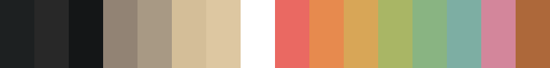

# Gogh

A dark, warm Neovim colorscheme (Gruvbox Material-derived) with a matching
kitty terminal theme.



## Install

**vim.pack** (Neovim 0.12+), in `init.lua`:

```lua
vim.pack.add({ { src = "https://github.com/hugoocoto/gogh-theme" } })
vim.cmd.colorscheme("gogh")
```

Update later with `vim.pack.update()`.

**lazy.nvim**

```lua
{
  "hugoocoto/gogh-theme",
  lazy = false,
  priority = 1000,
  config = function()
    vim.cmd.colorscheme("gogh")
  end,
}
```
